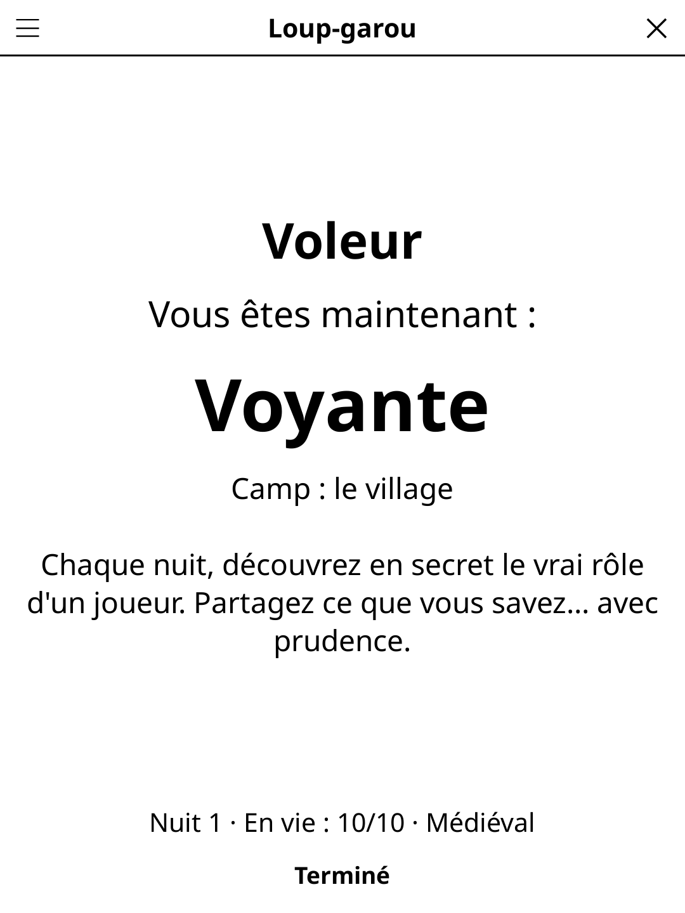

# werewolf.koplugin

A **Werewolf** (Loup-garou) game-master plugin for [KOReader](https://github.com/koreader/koreader): your e-reader runs the classic village party game for 6 to 18 players around a table.

## Screenshot

## Concept

A village hides a few werewolves. Every night the werewolves devour a villager; every day the village debates and votes to drive out a suspect. The reader deals the secret roles, tells the narration to read aloud, collects each role's secret choice at night, announces the deaths in the morning, records the vote and decides who has won.

## How to play

1. **Setup**: type the players' names (remembered for next time) and check the roles. A composition is suggested for the number of players; adjust it with − and +. Plain villagers fill the remaining seats.
2. **Distribution**: pass the reader around. Each player, alone, taps *Show my role*, reads the card and taps *Hide my role*.
3. **Night**: everybody closes their eyes. Whoever holds the reader reads the narration aloud. The role that is called opens their eyes, takes the reader, taps their choice in secret, then puts it down and closes their eyes. Dead roles are still called so nobody can tell.
4. **Day**: the reader announces the night's victims (with a different flavour line each time), the hunter fires his last shot, the village debates (optional timer) and the vote is recorded by tapping the eliminated player, or *No elimination*.
5. The game ends when one side has won. The final screen lists everybody's role, and the **game log** tells the whole story, night by night.

## Roles

22 roles. **Werewolves**: Werewolf, Big Bad Wolf (a second victim while no wolf has died), Accursed Wolf-Father (once per game, infects the pack's victim instead), White Werewolf (wins alone; may devour a werewolf every other night). **Village**: Villager, Seer, Witch (one healing and one death potion), Hunter, Cupid (lovers who die together; a werewolf–villager couple wins as the last two), Guard (never the same player twice in a row), Little Girl, Elder (survives the first attack; if the village kills him, the specialists lose their powers), Village Idiot, Fox (sniffs a player and their two neighbours), Raven (two votes against a player), Bear Tamer (the bear growls next to a werewolf), Knight with the Rusty Sword, Scapegoat (eliminated on a tie), the Two Sisters, Wild Child, Thief (two leftover cards on the first night). **Alone**: Pied Piper (wins when everybody else is charmed). Players sit in list order, since the fox, the bear tamer and the knight care about neighbours.

## Features

- **6–18 players**, suggested composition per table size, editable role by role
- **Pass-the-reader secrecy**: neutral hand-over screen, role shown only after a tap, full e-ink refresh after every secret screen so no ghost can be read
- **Narration in French and English**, several variants per step (over 300 lines per language), 40 funny death announcements
- **Five narration themes**: Classic village, Famous village (every player also gets a famous alias, "Alice (alias Napoléon)", from 270+ names per language), Medieval, Space station and Pirate ship, each with its own narration and announcements
- **Lots of narration**: 10 to 16 variants per night step, 80 night-death lines, 40 vote-out lines, 20 "nobody died" lines and 10+ lines for every other event, in English and French
- **Settings**: content language, theme, mayor election (the mayor's vote counts double), reveal roles on death (yes/no), debate timer (off, 1–5 min)
- **Save / restore**: the game is saved after every step; a resumed game never reopens on a secret screen
- Interface follows KOReader's language (English, French, Spanish, German)

## Installation

Copy the `werewolf.koplugin` folder into KOReader's `plugins/` directory, then open it from the Tools menu.

## License

GPL-3.0 — see [LICENSE](LICENSE).
